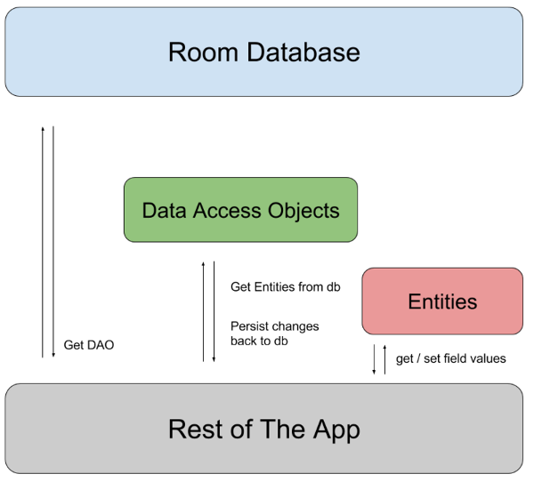

# Локальна база даних: Room Database

У попередніх уроках ми навчилися зберігати прості налаштування (через `DataStore`) та викачувати дані з Інтернету (через `Retrofit`). Але що робити, якщо додатку потрібно зберегти велику кількість структурованих даних (наприклад, тисячі контактів, історію повідомлень або скачані офлайн-статті), щоб вони були доступні без Інтернету?

Для цього операційна система Android має вбудовану легковажну реляційну базу даних — **SQLite**.

Проте писати сирі SQL-запити вручну та конвертувати таблиці в об'єкти Kotlin дуже важко і небезпечно. Тому Google створив бібліотеку **Room** — потужну обгортку над SQLite, яка перевіряє SQL-код ще на етапі компіляції і автоматично перетворює рядки з бази на Kotlin-об'єкти.

> 📖 **Поглиблене читання:** Детальна офіційна документація по роботі з Room від Google знаходиться за посиланням: [Save data in a local database using Room](https://developer.android.com/training/data-storage/room).

---

## 1. Архітектура Room Database

Щоб налаштувати базу даних Room, вам потрібно створити три обов'язкові компоненти:

1. **Entity (Сутність / Модель):** Data-клас, який описує структуру однієї таблиці в базі даних. Кожен об'єкт цього класу — це один рядок у таблиці.
2. **DAO (Data Access Object):** Інтерфейс, у якому ви оголошуєте методи доступу до бази (`Insert`, `Delete`, `Update`, `Query`). Room сам згенерує їхній код.
3. **Database (База даних):** Абстрактний клас, який об'єднує всі Entity та DAO разом і слугує головною точкою доступу до фізичного файлу бази на диску.

**Як ці компоненти взаємодіють між собою:**
Клас бази даних (`Database`) надає вашому додатку екземпляри об'єктів доступу до даних (`DAO`), пов'язані з цією базою. Своєю чергою, додаток використовує `DAO` для отримання даних з бази у вигляді екземплярів об'єктів сутностей (`Entity`). Додаток також може використовувати створені сутності `Entity` для оновлення відповідних рядків у таблицях бази або для створення нових рядків (вставки). Цю взаємодію наочно проілюстровано на схемі нижче:



---

## 2. Залежності та Плагін

Room використовує генерацію коду (KSP — Kotlin Symbol Processing) для створення реалізацій ваших інтерфейсів. 

**1. Кореневий файл (Project) `build.gradle.kts`:**
Спочатку потрібно оголосити версію плагіна KSP:
```kotlin
plugins {
    // ... інші плагіни ...
    id("com.google.devtools.ksp") version "2.3.10" apply false 
}
```

**2. Файл модуля (App) `build.gradle.kts`:**
Після цього ви можете застосувати плагін у вашому модулі (вже без вказівки версії):
```kotlin
plugins {
    // ... інші плагіни ...
    id("com.google.devtools.ksp") // Підключаємо плагін KSP
}
```

Потім додайте самі бібліотеки Room у блок `dependencies`:
```kotlin
dependencies {
    val room_version = "3.0.3"
    
    // Основна бібліотека Room
    implementation("androidx.room3:room3-runtime:$room_version")
    
    // Компілятор Room (обробник анотацій через KSP)
    ksp("androidx.room3:room3-compiler:$room_version")
}
```

> 💡 **Новий Room 3.x:** Починаючи з версії 3.0, Room підтримує **KMP (Kotlin Multiplatform)** (зверніть увагу на зміну префіксу пакетів на `androidx.room3`). Окрім того, підтримка `Coroutines` та `Flow` (яка раніше вимагала окремого пакету `room-ktx`) тепер **вбудована безпосередньо** у базовий пакет `room3-runtime`. Тому окремої залежності для `-ktx` більше не потрібно!

> ⚠️ *Примітка:* Щоб KSP запрацював, вам також потрібно додати його версію (яка відповідає вашій версії Kotlin) у файл `build.gradle.kts` рівня проекту!

---

## 3. Створення та використання бази даних Room

> 📦 **Початковий проект:** Заготовку проекту (базовий Compose UI) ви знайдете у репозиторії на GitHub: [krenevych/Compose](https://github.com/krenevych/Compose) (гілка **`main`**, модуль **`roomdb`**).<br>
> 💡 **Приклад розв'язку:** Готовий завершений код із реалізацією `Room` знаходиться на гілці **`roomdb`** (модуль **`roomdb`**).

### Крок 1: Створення Entity (Таблиці)

Створимо таблицю для збереження карток. Використовуємо анотацію **`@Entity`** перед звичайним Data-класом.

```kotlin
import androidx.room3.ColumnInfo
import androidx.room3.Entity
import androidx.room3.PrimaryKey

// Назва таблиці в базі буде "card_table"
@Entity(tableName = "card_table")
data class CardData(
    
    // Кожна таблиця зобов'язана мати первинний ключ.
    // autoGenerate = true означає, що SQLite сама буде нумерувати (1, 2, 3...)
    @PrimaryKey(autoGenerate = true)
    val id: Int = 0,

    // За замовчуванням колонка в базі назветься як і змінна, 
    // але ви можете змінити це через @ColumnInfo
    @ColumnInfo(name = "Title")
    val title: String = "Заголовок картки",
    
    @ColumnInfo(name = "Description")
    val description: String = "Це дуже детальний опис...",
    
    @ColumnInfo(name = "CreationTime")
    val creationTime: String = "2023-10-27 15:30"
)
```

---

### Крок 2: Створення DAO (Data Access Object)

Тут ми описуємо, ЯК саме ми хочемо працювати з таблицею. Це звичайний `interface` з анотацією **`@Dao`**.

```kotlin
import androidx.room3.Dao
import androidx.room3.Insert
import androidx.room3.OnConflictStrategy
import androidx.room3.Query
import kotlinx.coroutines.flow.Flow

@Dao
interface CardDao {

    // 1. ЗАПИС ДАНИХ (Виконується асинхронно через suspend)
    // OnConflictStrategy.REPLACE - якщо такий ID вже є, він оновиться
    @Insert(onConflict = OnConflictStrategy.REPLACE)
    suspend fun insertCard(card: CardData)

    // 2. ВИДАЛЕННЯ ДАНИХ
    @Query("DELETE FROM card_table WHERE id = :id")
    suspend fun deleteCardById(id: Int)

    // 3. ЗЧИТУВАННЯ ДАНИХ (Повертає реактивний Flow!)
    // Зверніть увагу: ми НЕ пишемо suspend для функцій, що повертають Flow!
    @Query("SELECT * FROM card_table ORDER BY Title ASC")
    fun getAllCards(): Flow<List<CardData>>
}
```

> 💡 **Магія Flow у Room:** Зверніть увагу на функцію `getAllCards()`. Оскільки вона повертає `Flow`, Room налаштує **автоматичний наглядач (Observer)** за цією таблицею. 
> Щоразу, коли ви викличете `insertCard` або `deleteCardById`, таблиця зміниться, і Room **АВТОМАТИЧНО згенерує новий список у Flow**. Ваш екран у Compose перемалюється миттєво без потреби викликати "оновити дані" вручну!

#### Основні операції та запити до БД

| Операція | Анотація або запит у DAO | Що робить |
| --- | --- | --- |
| Додавання | `@Insert` | Додає переданий об'єкт `CardData` як новий рядок таблиці. |
| Оновлення | `@Update` | Оновлює рядок за первинним ключем переданого об'єкта `CardData`. Якщо рядка немає, нічого не змінює. |
| Видалення об'єкта | `@Delete` | Видаляє рядок за первинним ключем переданого об'єкта `CardData`. |
| Отримання всіх карток | `@Query("SELECT * FROM card_table")` | Повертає всі рядки таблиці. |
| Пошук за ID | `@Query("SELECT * FROM card_table WHERE id = :id")` | Повертає картку із заданим ID. Для одноразового читання використовуйте тип результату `CardData?`, адже картки може не бути. |
| Сортування | `@Query("SELECT * FROM card_table ORDER BY Title ASC")` | Повертає картки за зростанням заголовка; `DESC` задає зворотний порядок. |
| Оновлення окремого поля | `@Query("UPDATE card_table SET Title = :title WHERE id = :id")` | Змінює лише заголовок картки із заданим ID. |
| Видалення за ID | `@Query("DELETE FROM card_table WHERE id = :id")` | Видаляє картку без потреби передавати цілий об'єкт. |
| Підрахунок карток | `@Query("SELECT COUNT(*) FROM card_table")` | Повертає кількість рядків, наприклад як `Int`. |

Позначення `:id` та `:title` — це параметри методу DAO з відповідними іменами. Для одноразового читання та зміни даних використовуйте `suspend`; для спостереження за результатами читання — `Flow` без `suspend`, як у прикладі вище.

> 📖 **Детальніше:** [Робота з даними через DAO в офіційній документації Room](https://developer.android.com/training/data-storage/room/accessing-data).

---

### Крок 3: Створення Database (Бази даних)

Створюємо абстрактний клас бази даних, який наслідується від `RoomDatabase`. 

```kotlin
import android.content.Context
import androidx.room3.Database
import androidx.room3.Room
import androidx.room3.RoomDatabase

// Вказуємо список усіх таблиць (entities) та версію бази даних
@Database(entities = [CardData::class], version = 1)
abstract class CardDatabase : RoomDatabase() {

    // Метод, через який ми отримуватимемо доступ до нашого DAO
    abstract fun cardDao(): CardDao

    companion object {
        // Запобігаємо створенню кількох екземплярів бази в пам'яті (Singleton)
        @Volatile
        private var INSTANCE: CardDatabase? = null

        fun getDatabase(context: Context): CardDatabase {
            return INSTANCE ?: synchronized(this) {
                // Подвійна перевірка (Double-checked locking) для потокобезпеки
                INSTANCE?.let { return it }
                
                val instance = Room.databaseBuilder(
                    context.applicationContext,
                    CardDatabase::class.java,
                    "Cards" // Назва фізичного файлу бази на диску
                ).build()
                
                INSTANCE = instance
                instance
            }
        }
    }
}
```

#### Навіщо потрібна подвійна перевірка `INSTANCE`?

Ми хочемо створити **один спільний екземпляр `CardDatabase`** для додатка. Але `getDatabase()` можуть одночасно викликати різні потоки. Перевірка «якщо бази ще немає — створи її» складається з кількох дій, між якими інший потік також може почати створення бази.

У коді є дві перевірки, і кожна має свою роль:

* **Перша — `INSTANCE ?: synchronized(this) { ... }`.** Якщо екземпляр уже існує, повертаємо його одразу, без блокування. Якщо `INSTANCE == null`, намагаємося увійти в `synchronized`.
* **Друга — `INSTANCE?.let { return it }`.** Після входу в `synchronized` перевіряємо значення повторно: поки потік чекав на блокування, інший потік міг уже створити екземпляр. Якщо він є, `return it` повертає його з `getDatabase()`.

Розгляньмо ситуацію з двома потоками:

1. Потоки **А** та **Б** майже одночасно виконують першу перевірку. Обидва бачать `INSTANCE == null`.
2. Потік **А** першим входить у `synchronized(this)`. Потік **Б** чекає: блок із тим самим об'єктом блокування може виконувати лише один потік одночасно. Тут `this` — спільний `companion object`.
3. Потік **А** повторно перевіряє `INSTANCE`, створює базу, записує її в `INSTANCE` та звільняє блокування.
4. Потік **Б** входить у блок. **Без другої перевірки він створив би ще один екземпляр**, адже першу перевірку вже пройшов раніше. Завдяки `INSTANCE?.let { return it }` він повертає екземпляр, створений потоком **А**.

Отже, перша перевірка дозволяє швидко отримувати вже створену базу, а друга запобігає повторному створенню після очікування блокування. Це і є **Double-checked locking**.

**А навіщо `@Volatile`?** Перша перевірка читає `INSTANCE` поза `synchronized`. Анотація гарантує видимість записаного значення для інших потоків: потік, який прочитає посилання на базу, також побачить результати її ініціалізації. Самої `@Volatile` недостатньо: вона не робить усю послідовність «перевірити → створити → присвоїти» неподільною, тому блокування та повторна перевірка залишаються потрібними.

> 📖 **Детальніше:** [`synchronized`](https://kotlinlang.org/api/core/kotlin-stdlib/kotlin/synchronized.html) та [`@Volatile`](https://kotlinlang.org/api/core/kotlin-stdlib/kotlin.jvm/-volatile/) в офіційній документації Kotlin.

---

### Крок 4: Використання у ViewModel та Compose

Залишилося лише з'єднати наш чудовий реактивний `Dao` з інтерфейсом користувача через ViewModel.

#### ViewModel:
```kotlin
class CardsViewModel(application: Application) : AndroidViewModel(application) {
    
    // Отримуємо екземпляр DAO
    private val cardDao = AppDatabase.getDatabase(application).cardDao()

    // 1. Отримуємо холодний Flow з Room і перетворюємо його у гарячий StateFlow для Compose
    val allCards: StateFlow<List<CardData>> = cardDao.getAllCards()
        .stateIn(
            scope = viewModelScope,
            started = SharingStarted.WhileSubscribed(5000),
            initialValue = emptyList() // Поки база вантажиться, список порожній
        )

    // 2. Метод для додавання нової картки
    fun addCard(title: String, description: String) {
        viewModelScope.launch {
            val newCard = CardData(title = title, description = description)
            cardDao.insertCard(newCard) // Зберігаємо у фоновому потоці
        }
    }
    
    // 3. Метод для видалення
    fun removeCard(id: Int) {
        viewModelScope.launch {
            cardDao.deleteCardById(id)
        }
    }
}
```

#### Compose UI:
```kotlin
@Composable
fun CardsScreen(viewModel: CardsViewModel) {
    // Безпечно підписуємося на реактивний потік з бази даних!
    val cardsList by viewModel.allCards.collectAsStateWithLifecycle()

    Column(modifier = Modifier.padding(16.dp)) {
        
        Button(onClick = { viewModel.addCard("Нова картка", "Опис...") }) {
            Text("Додати картку")
        }

        Spacer(modifier = Modifier.height(16.dp))

        // Відображаємо список
        LazyColumn {
            items(
                items = cardsList,
                key = { card -> card.id }
            ) { card ->
                // Тут можна застосувати SwipeToDismissBox, як ми вчили раніше!
                Card(modifier = Modifier.fillMaxWidth().padding(4.dp)) {
                    Text(
                        text = "ID: ${card.id} | ${card.title}",
                        modifier = Modifier.padding(16.dp)
                    )
                }
            }
        }
    }
}
```

Коли ви натискаєте на кнопку "Додати", дані записуються у файл `app_database.db`. Room бачить зміну у файлі і автоматично виштовхує новий `List<UserEntity>` у ваш `StateFlow`. UI самостійно малює новий рядок!

---

## Підсумок
* **`Room`** — це найбезпечніший і найзручніший спосіб роботи з локальними базами даних SQLite в Android.
* Складається з трьох рівнів: **`Entity`** (модель/таблиця), **`Dao`** (інтерфейс запитів), **`Database`** (файл бази та зв'язка).
* Запити з модифікатором `@Query` перевіряються системою на правильність SQL-коду **ще під час компіляції** (ви ніколи не впадете з помилкою через синтаксис під час роботи додатка).
* Використовуйте функції, що повертають **`Flow`** у `Dao`, щоб мати повністю реактивний UI, який оновлюється сам при будь-яких змінах у таблиці!
