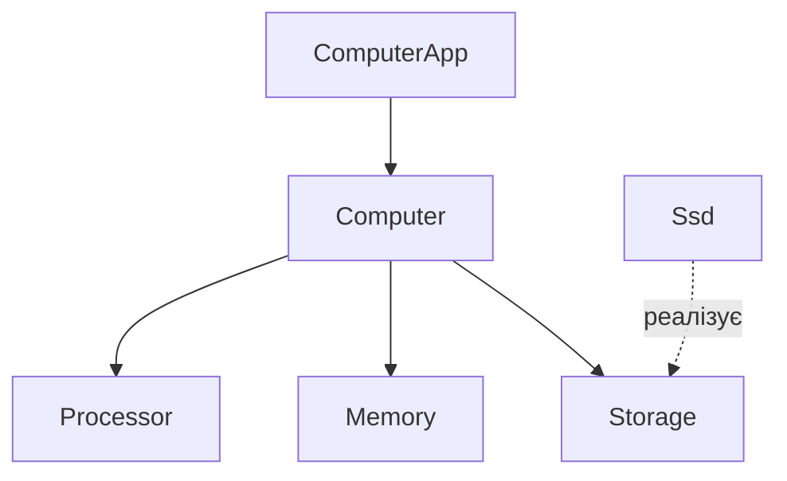

# Dependency Injection: хто збирає комп’ютер?

Комп’ютеру для роботи потрібні процесор, оперативна пам’ять і накопичувач. У програмі ми можемо представити їх окремими об’єктами. Але хто має створювати ці об’єкти та обирати, які саме компоненти встановити?

На цьому прикладі розберемо **Dependency Injection (DI)** — передавання об’єкту потрібних йому залежностей ззовні. Усі приклади написані на звичайному Kotlin: для них достатньо консольного проєкту, Android і додаткові бібліотеки не потрібні.

Перед читанням варто знати класи, конструктори та інтерфейси Kotlin. Приклади розвиваються поступово: нова версія класу замінює попередню, а не додається поруч із нею в тому самому файлі.

## 1. Що таке залежність?

Якщо об’єкт використовує інший об’єкт для виконання своєї роботи, він **залежить** від нього.

Створимо спрощені компоненти комп’ютера:

```kotlin
class Processor {
    fun start() = println("Процесор запущено")
}

class Memory {
    fun initialize() = println("Оперативну пам’ять підготовлено")
}

class Ssd {
    fun readBootData(): String = "Операційна система з SSD"
}

class Computer {
    private val processor = Processor()
    private val memory = Memory()
    private val storage = Ssd()

    fun boot() {
        processor.start()
        memory.initialize()
        println(storage.readBootData())
    }
}

fun main() {
    val computer = Computer()
    computer.boot()
}
```

`Processor`, `Memory` і `Ssd` — залежності `Computer`. Під час завантаження комп’ютер викликає їхні методи.

Це лише модель для навчання: ми показуємо взаємодію об’єктів, а не відтворюємо справжню послідовність запуску апаратного забезпечення.

## 2. У чому проблема самостійного створення компонентів?

Зараз `Computer` виконує дві роботи:

1. Координує завантаження комп’ютера.
2. Створює конкретну конфігурацію компонентів.

Для невеликого прикладу це працює. Але уявімо, що потрібно зібрати два комп’ютери з різними накопичувачами або перевірити завантаження на заздалегідь підготовлених даних.

Конфігурація захована всередині `Computer`: виклик `Computer()` завжди створює нові `Processor`, `Memory` і `Ssd`. Щоб змінити накопичувач, доведеться змінювати сам клас. А щоб підставити навчальну реалізацію, ми поки що взагалі не маємо відповідного параметра.

Уявіть, що корпус комп’ютера сам виробляє всі компоненти під час складання. Зручніше, коли компоненти обирає та встановлює той, хто збирає комп’ютер.

## 3. Передаємо залежності через конструктор

Залишимо класи компонентів без змін, а `Computer` перепишемо:

```kotlin
class Computer(
    private val processor: Processor,
    private val memory: Memory,
    private val storage: Ssd
) {
    fun boot() {
        processor.start()
        memory.initialize()
        println(storage.readBootData())
    }
}

fun main() {
    val processor = Processor()
    val memory = Memory()
    val storage = Ssd()

    val computer = Computer(processor, memory, storage)
    computer.boot()
}
```

**Це вже Dependency Injection.** Залежності створюються ззовні та передаються об’єкту через конструктор. Такий спосіб називають **constructor injection** — ін’єкцією через конструктор.

Слово «ін’єкція» тут означає звичайне передавання посилання на об’єкт. Ніякого спеціального механізму виконання не з’явилося.

Тепер `Computer` використовує готові компоненти. За їх створення та складання відповідає `main()`. З обов’язковими параметрами конструктора також не можна випадково створити комп’ютер без пам’яті чи процесора.

Зверніть увагу: ми вже застосували DI, хоча ще не додали жодного інтерфейсу. **Інтерфейси не є обов’язковою умовою DI.**

## 4. Як замінити SSD на інший накопичувач?

Попередній крок відокремив створення об’єктів від використання. Але параметр `storage: Ssd` усе ще дозволяє передати лише об’єкт цього типу. Щоб підтримати різні накопичувачі, визначимо спільний контракт:

```kotlin
interface Storage {
    fun readBootData(): String
}

class Ssd : Storage {
    override fun readBootData(): String = "Операційна система з SSD"
}

class Hdd : Storage {
    override fun readBootData(): String = "Операційна система з HDD"
}
```

Тепер у конструкторі `Computer` замінимо тип накопичувача на `Storage`:

```kotlin
class Computer(
    private val processor: Processor,
    private val memory: Memory,
    private val storage: Storage
) {
    fun boot() {
        processor.start()
        memory.initialize()
        println(storage.readBootData())
    }
}

fun main() {
    val officeComputer = Computer(Processor(), Memory(), Hdd())
    val gamingComputer = Computer(Processor(), Memory(), Ssd())

    officeComputer.boot()
    gamingComputer.boot()
}
```

`Computer` знає, що накопичувач уміє читати дані для завантаження. Яким способом він це робить — відповідальність конкретної реалізації.

Тут працюють два окремі рішення:

| Рішення | Що воно дає |
| --- | --- |
| Передавання залежності через конструктор | Дозволяє обирати та створювати її ззовні |
| Залежність від інтерфейсу `Storage` | Дозволяє передавати різні реалізації одного контракту |

Для процесора й пам’яті ми поки залишили конкретні класи. Інтерфейс варто вводити там, де він має зрозумілу користь: наприклад, потрібні різні реалізації або підміна в перевірці поведінки.

## 5. Підміняємо компонент для перевірки

Припустимо, нам потрібно перевірити, чи звертається комп’ютер до накопичувача під час завантаження. Створимо просту тестову реалізацію `Storage`, яка повертає підготовлені дані та рахує звернення:

```kotlin
class TestStorage : Storage {
    var readCount: Int = 0
        private set

    override fun readBootData(): String {
        readCount++
        return "Тестова операційна система"
    }
}

fun main() {
    val storage = TestStorage()
    val computer = Computer(Processor(), Memory(), storage)

    computer.boot()

    check(storage.readCount == 1) {
        "Під час завантаження очікувалося одне читання накопичувача"
    }
}
```

`check()` кине виняток, якщо умова хибна. Таку невелику перевірку можна виконати без тестової бібліотеки.

Код `Computer` не змінився. Ми замінили лише об’єкт, який передали в конструктор. У реальних програмах так само можна підставити джерело підготовлених даних замість мережевого клієнта чи бази.

Ця перевірка доводить тільки те, що відбулося одне звернення до накопичувача. Вона не перевіряє правильність усієї процедури завантаження чи обробку помилок.

## 6. Ін’єкція в поля: компоненти після створення комп’ютера

Досі ми передавали компоненти під час створення `Computer`. Інший спосіб — спочатку створити об’єкт, а потім передати залежності через його доступні для запису властивості. Цей підхід називають **ін’єкцією в поля (field injection)**. У прикладах на Kotlin точніше говорити про **ін’єкцію у властивості (property injection)**: звичайне присвоєння властивості виконується через її setter.

Для порівняння створимо окремий клас `FieldInjectedComputer`. Класи `Processor`, `Memory` та інтерфейс `Storage` з його реалізаціями залишаються з попередніх прикладів.

```kotlin
class FieldInjectedComputer {
    lateinit var processor: Processor
    lateinit var memory: Memory
    lateinit var storage: Storage

    fun boot() {
        processor.start()
        memory.initialize()
        println(storage.readBootData())
    }
}

fun main() {
    // Крок 1: об’єкт уже існує, але компонентів у нього ще немає.
    val computer = FieldInjectedComputer()

    // Крок 2: зовнішній код передає залежності у властивості.
    computer.processor = Processor()
    computer.memory = Memory()
    computer.storage = Ssd()

    // Крок 3: після встановлення всіх компонентів можна працювати.
    computer.boot()
}
```

Це також DI: компоненти створює зовнішній код, а комп’ютер отримує їх для використання. Відмінність — у моменті та способі передавання: залежності встановлюються **після виклику конструктора**.

### Що буде, якщо забути передати залежність?

```kotlin
fun main() {
    val computer = FieldInjectedComputer()
    computer.processor = Processor()
    computer.memory = Memory()
    // Накопичувач не встановили.

    computer.boot() // UninitializedPropertyAccessException при читанні storage
}
```

Цей код компілюється. Помилка виникає під час виконання, коли `boot()` звернеться до неініціалізованої властивості `storage`. Отже, **існування об’єкта ще не означає його готовність до роботи**.

У версії з обов’язковими параметрами конструктора виклик `Computer()` без компонентів не скомпілюється. У версії з полями зовнішній код повинен сам забезпечити правильний порядок: створити → передати всі залежності → використовувати. Зокрема, звертатися до цих `lateinit`-властивостей у блоці `init` зарано: зовнішнє присвоєння ще не відбулося.

### Залежність можна змінити пізніше

Властивості в нашому прикладі мають публічні setter-и, тому зовнішній код може виконати `computer.storage = Hdd()` навіть після першого завантаження. Наступний виклик `boot()` використає новий накопичувач.

Іноді заміна залежності потрібна, але для обов’язкових незмінних компонентів це зайва можливість. Передавання через конструктор із `private val` дозволяє зафіксувати посилання на залежність. При цьому сам переданий об’єкт не обов’язково є незмінним.

### Який спосіб обрати?

| Питання | Через конструктор | У поля / властивості, як у прикладі |
| --- | --- | --- |
| Коли передаються залежності? | Під час створення об’єкта | Після створення об’єкта |
| Де видно обов’язкові залежності? | У параметрах конструктора | В оголошеннях властивостей і коді їх заповнення |
| Чи можна пропустити обов’язковий компонент? | Без аргументу виклик не скомпілюється | Так, помилка виявиться при читанні `lateinit` |
| Чи можна зафіксувати посилання через `val`? | Так | Ні, присвоєння ззовні потребує можливості запису |
| Хто відповідає за готовність до використання? | Обов’язкові аргументи забезпечує виклик конструктора | Код, який створює об’єкт і заповнює властивості |

**Для обов’язкових залежностей у власних класах починайте з ін’єкції через конструктор.** Ін’єкція в поля корисна, коли об’єкт створює сторонній механізм і ми не можемо передати потрібні аргументи в його конструктор, але маємо можливість налаштувати об’єкт до початку роботи. Тоді потрібно чітко знати, коли залежності вже встановлені.

Заміна `lateinit var storage: Storage` на `var storage: Storage? = null` сама по собі не вирішує проблему готовності. Якщо накопичувач обов’язковий, перевірка `storage?.readBootData()` може просто приховати пропущене налаштування. Nullable-властивість доречна, коли відсутність компонента є дозволеним станом і поведінка без нього визначена явно.

### Виносимо заповнення властивостей у `inject()`

У попередньому прикладі `main()` знає всі деталі складання: які компоненти створити та в які властивості їх записати. Винесемо це в окремий **компонент** — клас, який створює залежності та передає їх об’єктам:

```kotlin
class ComputerComponent {
    private fun createStorage(): Storage {
        return Ssd()
    }

    fun inject(computer: FieldInjectedComputer) {
        computer.processor = Processor()
        computer.memory = Memory()
        computer.storage = createStorage()
    }
}

fun main() {
    val computer = FieldInjectedComputer()
    val component = ComputerComponent()

    component.inject(computer)

    computer.boot()
}
```

`FieldInjectedComputer` залишається без змін. Три присвоєння тепер заховані за одним викликом `component.inject(computer)`.

Розберемо відповідальність кожної частини:

1. `main()` створює об’єкт, якому потрібні залежності, та передає його компоненту.
2. `ComputerComponent` знає, які реалізації обрати та як їх створити. Наприклад, `createStorage()` повертає `Ssd` як `Storage`.
3. `inject()` отримує посилання на **вже створений об’єкт** і заповнює його властивості.
4. Після завершення `inject()` можна викликати `boot()`.

Метод `inject()` у цьому прикладі повертає `Unit`: він змінює переданий об’єкт, а не створює новий комп’ютер. Назва `inject` — домовленість для читача, а не спеціальне слово Kotlin. Усередині виконуються звичайні присвоєння.

Обгортка централізує налаштування, але не змінює правила `lateinit`. Якщо не викликати `inject()` або забути заповнити одну з властивостей у його тілі, помилка все одно виникне при читанні цієї властивості. Повторний виклик нашого `inject()` створить нові компоненти та замінить попередні посилання.

### Конструктори та властивості можуть працювати разом

Компонент може збирати залежності через конструктори, а готовий результат передавати у властивість іншого об’єкта. Наприклад, звичайний консольний застосунок використовуватиме вже знайомий `Computer` з ін’єкцією через конструктор:

```kotlin
class ComputerApp {
    lateinit var computer: Computer

    fun run() {
        computer.boot()
    }
}

class AppComponent {
    private fun createComputer(): Computer {
        val processor = Processor()
        val memory = Memory()
        val storage = Ssd()

        // Ін’єкція через конструктор: складаємо залежність.
        return Computer(processor, memory, storage)
    }

    fun inject(app: ComputerApp) {
        // Ін’єкція у властивість: передаємо готову залежність.
        app.computer = createComputer()
    }
}

fun main() {
    val app = ComputerApp()
    AppComponent().inject(app)
    app.run()
}
```

Тут `Computer` отримує компоненти під час створення, а `ComputerApp` отримує готовий комп’ютер після свого створення. Обирати один спосіб ін’єкції для всіх класів програми не потрібно.

### Компонент як контейнер залежностей

`AppComponent` виконує роль контейнера залежностей: він знає, які об’єкти створити та як їх з’єднати. Вкладені залежності утворюють граф:



Суцільні стрілки показують залежності об’єктів, пунктирна — реалізацію контракту `Storage`. `AppComponent` збирає цей граф: створює компоненти комп’ютера, передає їх у конструктор `Computer`, а готовий комп’ютер записує у властивість `ComputerApp`.

Місце, де створюють і з’єднують об’єкти програми, називають **Composition Root** — місцем складання залежностей. У нашій програмі це `main()` разом із викликаним звідти `AppComponent`, у який ми винесли деталі складання.

Зверніть увагу на різницю двох методів: `createComputer()` створює та повертає новий об’єкт, а `inject(app)` заповнює залежності вже створеного `app`. Вони можуть працювати в одному компоненті: у нашому прикладі `inject()` викликає приватний `createComputer()`.

Сам `ComputerApp` нічого не знає про компонент. **Не потрібно передавати весь контейнер у `ComputerApp` або `Computer`**, щоб вони самі діставали з нього залежності. У такому разі список потрібних залежностей знову ховатиметься всередині класу. Підхід, коли об’єкт сам запитує залежності у спільного реєстру, називають **Service Locator**.

### Хто визначає час життя компонентів?

DI сам по собі не робить об’єкти єдиними для всієї програми. У нашому `AppComponent` кожен виклик `inject(app)` через `createComputer()` створює новий комп’ютер і нові компоненти. Навіть повторне використання того самого `AppComponent` не забезпечить спільних екземплярів автоматично.

Якщо зберегти залежність у властивості компонента та передавати її кільком об’єктам, вони отримають спільний екземпляр. Це окреме рішення про час життя та спільне використання об’єктів. Воно залежить від задачі: у нашій моделі кожен новий комп’ютер отримує власні компоненти.

### Перехід до автоматизації

Ця схема допоможе згодом перейти до Hilt: ручний компонент уже показує роботу зі створення графа залежностей і заповнення властивостей. Hilt автоматизує цю роботу та інтегрує її з життєвим циклом підтримуваних Android-компонентів. Для Activity з Hilt використовують `@AndroidEntryPoint` і поля з `@Inject`; ручний виклик `Component().inject(this)` у звичайному сценарії більше не потрібний. Налаштування бібліотеки розглянемо окремо. [Документація Hilt](https://developer.android.com/training/dependency-injection/hilt-android).

## 7. DI, IoC та Dependency Inversion: різні поняття

Ці терміни часто зустрічаються поруч, але описують різні речі:

| Поняття | Значення на нашому прикладі |
| --- | --- |
| **Dependency Injection (DI)** — ін’єкція залежностей | Комп’ютер отримує компоненти ззовні через конструктор або властивості |
| **Inversion of Control (IoC)** — інверсія керування | Керування створенням і вибором компонентів передане від `Computer` зовнішньому коду; DI є одним зі способів реалізувати IoC |
| **Dependency Inversion Principle (DIP)** — принцип інверсії залежностей | Логіка завантаження залежить від контракту `Storage`, а конкретні накопичувачі реалізують цей контракт |

DIP стосується залежності високорівневої логіки та низькорівневих деталей від абстракцій. У нашому прикладі `Computer` використовує `Storage`, а `Ssd` і `Hdd` підлаштовуються під цей контракт. Просто наявності будь-якого інтерфейсу в програмі недостатньо, щоб вважати весь її дизайн реалізацією DIP.

Ми отримали DI ще на кроці з конкретним `Ssd` у конструкторі. Перехід до `Storage` додав незалежність від конкретного виду накопичувача.

## 8. Чи потрібна спеціальна бібліотека?

Усе, що ми зробили, — **ручний DI (manual DI)**. Звичайних конструкторів або присвоєнь властивостям Kotlin достатньо для передавання залежностей.

DI-фреймворки допомагають автоматизувати складання великих графів залежностей і керування часом життя об’єктів. Проте рішення, які класи існують, за що відповідають і які залежності отримують, залишається за розробником.

Так само DI можна застосовувати без Clean Architecture. У наступній темі можна перейти від питання «як передати компонент?» до питання «які компоненти мають знати один про одного?» та розглянути межі архітектурних шарів.

Основна ідея DI: **об’єкт отримує потрібні йому залежності ззовні, а їх створення та складання виконуються окремо від використання.**

Практика та контрольні запитання: [«Dependency Injection — компоненти комп’ютера»](../../Tutorials/10_Architecture/01_Dependency_InjectionTask.md).
