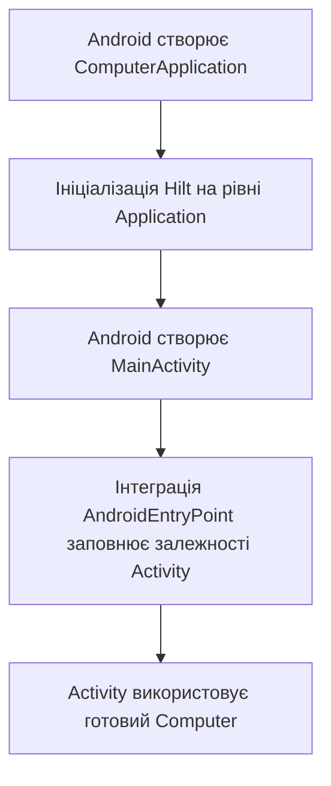
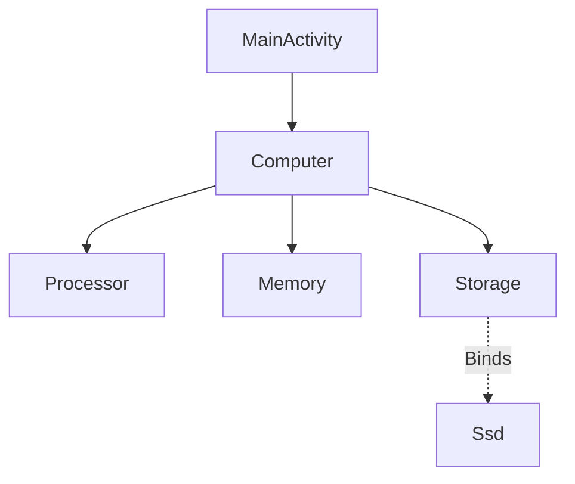
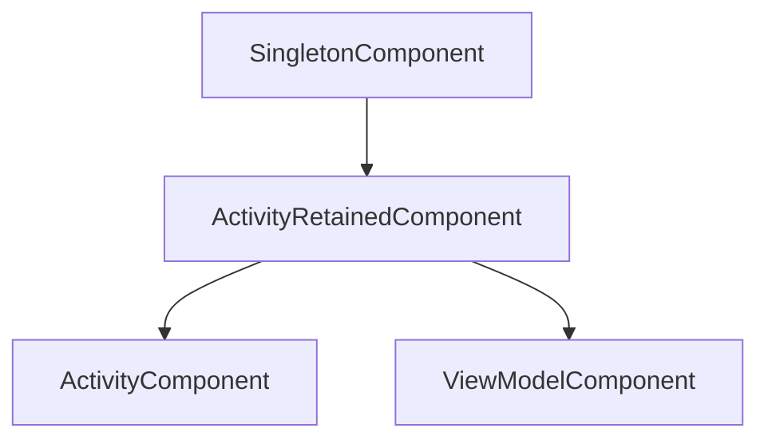

# Hilt: від ручного `inject()` до автоматичного складання залежностей

У [попередньому розділі](01_Dependency_Injection.md) ми створили компонент, який збирав комп’ютер і передавав його в об’єкт застосунку:

```kotlin
fun inject(app: ComputerApp) {
    app.computer = createComputer()
}
```

Зі зростанням програми таких методів стає більше. Потрібно підтримувати порядок створення об’єктів, передавати вкладені залежності та визначати, які екземпляри використовувати спільно.

**Hilt** автоматизує цю роботу в Android. Він побудований на Dagger, який генерує код складання залежностей під час збірки. Ми описуємо правила створення об’єктів, а Hilt надає компоненти, пов’язані з життєвими циклами Android. [Огляд Hilt](https://developer.android.com/training/dependency-injection/hilt-android), [генерація коду в Dagger](https://dagger.dev/dev-guide/).

Продовжимо приклад із комп’ютером, але тепер використовуватимемо його в Android-застосунку. Для читання потрібні попередня тема про DI та знайомство з Activity, Application, ViewModel і Compose. Приклади класів розміщуйте в окремих Kotlin-файлах свого пакета; змінені версії замінюють попередні.

## 1. Яку роботу ми передаємо Hilt?

Зіставимо ручний підхід із тим, до чого прийдемо:

| У ручному DI | З Hilt |
| --- | --- |
| `createComputer()` викликає конструктор з потрібними аргументами | `@Inject constructor` описує спосіб створення класу |
| Компонент обирає `Ssd` для параметра `Storage` | `@Binds` пов’язує інтерфейс із реалізацією |
| Функція створює об’єкт через Builder або фабрику | `@Provides` описує таке створення |
| `component.inject(activity)` заповнює властивості Activity | `@AndroidEntryPoint` підключає Activity до Hilt, `@Inject` позначає її залежності |
| Компонент зберігає об’єкт у властивості для повторного використання | Scope визначає повторне використання в межах компонента |

Наше завдання — перетворити конфігурацію ручного компонента на явні правила. Логіка `Computer.boot()` від цього не змінюється.

## 2. Підключення до Android-проєкту

Використаємо Android-проєкт із підтримкою Compose та вже налаштованими базовими залежностями Activity, Lifecycle і Material 3. Нижче наведено доповнення до його конфігурації.

### Gradle-плагіни та бібліотеки

У кореневому `build.gradle.kts`:

```kotlin
plugins {
    // Наявні плагіни проєкту залишаються.
    id("com.google.devtools.ksp") version "2.3.10" apply false
    id("com.google.dagger.hilt.android") version "2.60.1" apply false
}
```

Якщо KSP уже підключений для Room, повторно оголошувати його не потрібно. У проєкті з Version Catalog відповідні версії та плагіни можна зберігати в `libs.versions.toml`.

У `app/build.gradle.kts`:

```kotlin
plugins {
    // Наявні плагіни Android і Compose залишаються.
    id("com.google.devtools.ksp")
    id("com.google.dagger.hilt.android")
}

dependencies {
    val hiltVersion = "2.60.1"

    implementation("com.google.dagger:hilt-android:$hiltVersion")
    ksp("com.google.dagger:hilt-compiler:$hiltVersion")
}
```

Версії наведено за документацією, перевіреною 9 листопада 2026 року. Плагін Hilt, runtime і compiler мають однакову версію.

Використовуйте узгоджений JVM target, наприклад 17, у налаштуваннях Java та Kotlin.

`implementation` додає код бібліотеки для застосунку. Через `ksp` підключаємо обробник, який генерує код під час збірки. Після Gradle Sync виконайте збірку проєкту: одного Sync недостатньо для перевірки графа.

Джерела налаштувань: [Hilt Gradle Setup](https://dagger.dev/hilt/gradle-setup.html), [KSP Quickstart](https://kotlinlang.org/docs/ksp-quickstart.html).

## 3. Клас Application

### Навіщо Hilt потрібен Application?

У консольному прикладі точкою входу була функція `main()`: ми самі створювали компонент і запускали ін’єкцію. В Android об’єкти `Application` та Activity створює система, тому потрібно підключити складання залежностей до цього процесу.

З теми [Application](../04_Lifecycle/01_Application.md) ми вже знаємо, що Android створює об’єкт застосунку перед запуском Activity. Для нашого прикладу з одним процесом це спільна точка ініціалізації, яка не зникає під час повороту екрана. При новому запуску процесу об’єкт буде створений заново. [API Application](https://developer.android.com/reference/android/app/Application).

Hilt використовує цю точку для підключення кореневого контейнера залежностей — `SingletonComponent`. Від нього будуються інші компоненти Hilt, зокрема ті, що обслуговують Activity та ViewModel. Детальніше їхню ієрархію розглянемо в розділі 9. [Компоненти Hilt](https://dagger.dev/hilt/components.html).

### Що робить `@HiltAndroidApp`?

Створимо власний клас Application:

```kotlin
import android.app.Application
import dagger.hilt.android.HiltAndroidApp

@HiltAndroidApp
class ComputerApplication : Application()
```

У цьому оголошенні `Application()` означає виклик конструктора базового класу при створенні нашого об’єкта. А `@HiltAndroidApp` позначає клас, для якого Hilt має згенерувати інтеграцію з контейнером залежностей.

Варто розрізняти два етапи:

1. **Під час збірки** обробник Hilt генерує компоненти та базовий клас із кодом інтеграції. Gradle-плагін підключає згенеровану базу, тому в нашому коді залишається звичне `: Application()`.
2. **Під час виконання** Android створює `ComputerApplication`. Згенерована інтеграція забезпечує роботу контейнера Hilt та ін’єкцію залежностей Application.

Порожнього тіла класу достатньо: створювати `AppComponent` або викликати `inject(this)` вручну тут не потрібно. Якщо власний Application уже є, додайте анотацію до нього. [Hilt Application](https://dagger.dev/hilt/application.html), [роль Gradle-плагіна](https://dagger.dev/hilt/gradle-setup.html#why-use-the-plugin).

### Чому потрібен запис у Manifest?

Зареєструйте його в наявному `AndroidManifest.xml`, зберігши інші атрибути та компоненти:

```xml
<application
    android:name=".ComputerApplication"
    ... >
    <!-- Наявні Activity та інші компоненти -->
</application>
```

Це фрагмент: `...` позначає наявні атрибути, його не потрібно вставляти буквально. Якщо клас розміщений не в кореневому пакеті застосунку, укажіть відповідний шлях або повне ім’я класу.

Тут дві різні вказівки для різних учасників:

| Запис | Кому він потрібен | Що визначає |
| --- | --- | --- |
| `@HiltAndroidApp` | Інструментам збірки Hilt | Для якого Application генерувати інтеграцію |
| `android:name=".ComputerApplication"` | Android | Який клас Application створити під час запуску |

Анотація не реєструє клас у Manifest. Якщо не вказати власний Application, Android за замовчуванням створить стандартний `Application`, і підключення Hilt для нашого застосунку не запрацює. Створювати `ComputerApplication()` вручну теж не потрібно: це не замінить об’єкт, яким керує Android. [Створення Application](https://developer.android.com/reference/android/app/Application).

### Як це пов’язано з ін’єкцією в Activity?

У наступних розділах ми додамо правила створення комп’ютера та позначимо Activity анотацією `@AndroidEntryPoint`. Зв’язок між цими кроками такий:



Application підключає Hilt на рівні застосунку, а `@AndroidEntryPoint` підключає конкретну Activity. Самої анотації на Application недостатньо для заповнення властивостей усіх екранів. [Android Entry Points](https://dagger.dev/hilt/android-entry-point.html).

Ця схема не означає, що всі об’єкти створюються одразу під час запуску. Hilt отримує правила їх складання, а екземпляри створюються за запитами. Також `SingletonComponent` не робить усі залежності спільними автоматично — для цього потрібні відповідні scope.

Перевизначати `onCreate()` лише заради підключення Hilt не потрібно. Якщо в Application є власна ініціалізація, зберігайте виклик `super.onCreate()`: ін’єкція у властивості самого Application відбувається під час нього, тому використовувати ці властивості можна після цього виклику. [Ін’єкція в Application](https://dagger.dev/hilt/application.html).

## 4. `@Inject constructor`: як створити звичайний клас

Змінимо компоненти комп’ютера з попереднього розділу:

```kotlin
import javax.inject.Inject

class Processor @Inject constructor() {
    fun start() = println("Процесор запущено")
}

class Memory @Inject constructor() {
    fun initialize() = println("Оперативну пам’ять підготовлено")
}

interface Storage {
    fun readBootData(): String
}

class Ssd @Inject constructor() : Storage {
    override fun readBootData(): String = "Операційна система з SSD"
}

class Computer @Inject constructor(
    private val processor: Processor,
    private val memory: Memory,
    private val storage: Storage
) {
    fun boot() {
        processor.start()
        memory.initialize()
        println(storage.readBootData())
    }
}
```

`@Inject` перед конструктором повідомляє, який конструктор можна використати для створення об’єкта. Його параметри задають наступні залежності, які потрібно отримати.

Для `Processor` і `Memory` достатньо викликати конструктори без аргументів. Для `Computer` потрібно спочатку отримати три компоненти. Однак Hilt ще не знає, що для `Storage` ми обрали саме `Ssd`: це правило додамо наступним кроком. [Конструктори та граф залежностей у Dagger](https://dagger.dev/dev-guide/basic-usage).

Анотація не змінює можливість викликати конструктор вручну. Наприклад, для звичайної перевірки можна й далі написати `Computer(Processor(), Memory(), Ssd())`.

## 5. `@Binds`: яку реалізацію інтерфейсу обрати

Створимо файл `StorageModule.kt`:

```kotlin
import dagger.Binds
import dagger.Module
import dagger.hilt.InstallIn
import dagger.hilt.components.SingletonComponent

@Module
@InstallIn(SingletonComponent::class)
abstract class StorageModule {
    @Binds
    abstract fun bindStorage(implementation: Ssd): Storage
}
```

**Binding** — правило отримання залежності певного типу. Тут воно читається так: «Коли потрібен `Storage`, використай `Ssd`».

`@Binds`-метод не має тіла: ми описуємо відповідність типів. Для створення самого `Ssd` уже є `@Inject constructor`. Назва `bindStorage` допомагає читати код; відповідність задають тип параметра та тип результату. [Правила `@Binds`](https://dagger.dev/dev-guide/basic-usage#binds).

`@Module` об’єднує правила надання залежностей. Це звичайний Kotlin-клас, **не Gradle-модуль**. `@InstallIn` визначає компонент Hilt, у якому доступні ці правила. `SingletonComponent` дозволяє використовувати їх також у дочірніх компонентах, зокрема для Activity та ViewModel. Сам `@InstallIn(SingletonComponent::class)` не робить об’єкти singleton-ами. [Модулі Hilt](https://dagger.dev/hilt/modules.html).

## 6. `@AndroidEntryPoint`: хто викликає `inject()` для Activity

Тепер отримаємо комп’ютер у `MainActivity`:

```kotlin
import android.os.Bundle
import androidx.activity.ComponentActivity
import androidx.activity.compose.setContent
import androidx.compose.material3.Button
import androidx.compose.material3.MaterialTheme
import androidx.compose.material3.Text
import dagger.hilt.android.AndroidEntryPoint
import javax.inject.Inject

@AndroidEntryPoint
class MainActivity : ComponentActivity() {
    @Inject
    lateinit var computer: Computer

    override fun onCreate(savedInstanceState: Bundle?) {
        super.onCreate(savedInstanceState)

        setContent {
            MaterialTheme {
                Button(onClick = { computer.boot() }) {
                    Text("Запустити комп’ютер")
                }
            }
        }
    }
}
```

Раніше зовнішній компонент виконував `activity.computer = createComputer()`. Тепер `@AndroidEntryPoint` підключає Activity до механізму Hilt, а `@Inject` позначає властивість для заповнення. Ручний `Component().inject(this)` прибираємо.

Для Activity ін’єкція виконується під час `super.onCreate()`. Після цього виклику залежність доступна; у конструкторі, `init` чи ініціалізаторі іншої властивості користуватися нею зарано. [Android Entry Points](https://dagger.dev/hilt/android-entry-point.html).

Властивість для ін’єкції Hilt не може бути `private`. Також одна лише анотація `@Inject` не заповнює довільний об’єкт, створений через `SomeClass()`: у цьому прикладі ін’єкцію запускає інтеграція Activity з Hilt. [Ін’єкція в Android-класи](https://developer.android.com/training/dependency-injection/hilt-android#android-classes).

На цьому етапі маємо завершений приклад: `ComputerApplication`, зареєстрований у Manifest, класи з розділу 4, `StorageModule` і `MainActivity`. Повідомлення від `println()` можна переглядати в Logcat.

## 7. Як Hilt проходить граф залежностей

Для заповнення `MainActivity.computer` потрібен такий граф:



Стрілки показують, які залежності потрібні об’єктам, а пунктирна — правило вибору реалізації.

Логіку складання можна уявити так:

1. Для властивості `computer` потрібен `Computer`.
2. Його конструктор потребує `Processor`, `Memory` і `Storage`.
3. Для перших двох є конструктори з `@Inject`.
4. Модуль пов’язує `Storage` із `Ssd`, для якого також є `@Inject constructor`.
5. Згенерований код створює потрібні об’єкти та записує комп’ютер у властивість Activity.

Це пояснення графа, а не точний лістинг згенерованого коду. Якщо прибрати binding для `Storage`, збірка повідомить про відсутнє правило, зазвичай із позначкою `[Dagger/MissingBinding]`. Додавання самого інтерфейсу не говорить Hilt, яку реалізацію обрати. [Побудова графа Dagger](https://dagger.dev/dev-guide/basic-usage#building-the-graph).

## 8. `@Provides`: якщо створення потребує власного коду

Не до кожного конструктора можна додати `@Inject`. Клас може бути частиною сторонньої бібліотеки або створюватися через фабрику чи Builder.

Покажемо цей випадок на накопичувачі з фабричним методом. Припустимо, цей клас надає зовнішня бібліотека:

```kotlin
class ExternalStorage private constructor(
    private val bootData: String
) : Storage {
    override fun readBootData(): String = bootData

    companion object {
        fun open(): ExternalStorage {
            return ExternalStorage("Операційна система із зовнішнього сховища")
        }
    }
}
```

Щоб обрати його замість `Ssd`, **замініть попередній `StorageModule`**:

```kotlin
import dagger.Module
import dagger.Provides
import dagger.hilt.InstallIn
import dagger.hilt.components.SingletonComponent

@Module
@InstallIn(SingletonComponent::class)
object StorageModule {
    @Provides
    fun provideStorage(): Storage {
        return ExternalStorage.open()
    }
}
```

`@Provides`-метод має тіло та повертає створений об’єкт. Якщо йому потрібні залежності, їх оголошують параметрами — Hilt надасть їх за відповідними правилами. Так можна описати створення Retrofit через Builder або Room через `databaseBuilder`. [Надання екземплярів у Dagger](https://dagger.dev/dev-guide/basic-usage#satisfying-dependencies).

Тепер `Computer` отримає `ExternalStorage`, хоча сам клас `Computer` не змінився. Не залишайте одночасно обидва модулі з некваліфікованим binding для `Storage`: це два правила для одного запиту, і збірка повідомить про дублювання.

| Ситуація | Спосіб описати створення |
| --- | --- |
| Власний клас із доступним конструктором | `@Inject constructor` |
| Потрібно пов’язати інтерфейс з реалізацією, яку Hilt уміє створювати | `@Binds` |
| Потрібна фабрика, Builder або власна логіка створення | `@Provides` |

## 9. Компоненти та scope: які екземпляри використовуються спільно

Компонент Hilt — контейнер із визначеним часом життя. Scope задає повторне використання binding у межах екземпляра такого компонента:

| Компонент | Scope | Межі повторного використання |
| --- | --- | --- |
| `SingletonComponent` | `@Singleton` | Процес застосунку |
| `ActivityRetainedComponent` | `@ActivityRetainedScoped` | Логічна Activity, включно зі змінами конфігурації |
| `ActivityComponent` | `@ActivityScoped` | Один екземпляр Activity; після повороту створюється новий |
| `ViewModelComponent` | `@ViewModelScoped` | Одна ViewModel |

Без scope новий запит зазвичай створює новий екземпляр. Щоб у нашій моделі використовувати спільний `Memory`, змініть його оголошення:

```kotlin
import javax.inject.Inject
import javax.inject.Singleton

@Singleton
class Memory @Inject constructor() {
    fun initialize() = println("Оперативну пам’ять підготовлено")
}
```

Тепер об’єкти, що отримують `Memory` через цей граф, використовують спільний екземпляр у межах `SingletonComponent`. Це навчальна конфігурація: у попередній моделі кожен комп’ютер мав власну пам’ять. Scope обирають за потрібним часом життя, а не додають усім класам.

Для `@Provides` або `@Binds` scope розміщують на методі. Він має відповідати компоненту з `@InstallIn`. `@Singleton` не зберігає дані після завершення процесу та не робить об’єкт потокобезпечним. [Компоненти та scope Hilt](https://dagger.dev/hilt/components.html).

### Які залежності доступні компоненту?

Компонент бачить власні binding-и та binding-и предків. Ось частина ієрархії Hilt:



Стрілки тут показують **ієрархію контейнерів**, на відміну від попередньої схеми залежностей класів. `ActivityComponent` і `ViewModelComponent` — сусідні гілки: binding із `ActivityComponent` недоступний ViewModel. Також singleton не може залежати від об’єкта, доступного лише в компоненті Activity. [Ієрархія компонентів](https://dagger.dev/hilt/components.html#component-hierarchy).

## 10. Hilt у ViewModel та Compose

Для ViewModel використовуємо конструкторну ін’єкцію та `@HiltViewModel`:

```kotlin
import androidx.lifecycle.ViewModel
import dagger.hilt.android.lifecycle.HiltViewModel
import javax.inject.Inject

@HiltViewModel
class ComputerViewModel @Inject constructor(
    private val computer: Computer
) : ViewModel() {
    fun boot() {
        computer.boot()
    }
}
```

Hilt забезпечує залежності, а отримання ViewModel відбувається через механізм Jetpack ViewModel. Для Activity можна використати `private val viewModel: ComputerViewModel by viewModels()` з імпортом `androidx.activity.viewModels`. Не отримуйте ViewModel через `@Inject lateinit var viewModel` і не створюйте її вручну в UI. [Hilt View Models](https://dagger.dev/hilt/view-model.html).

Для отримання ViewModel через `hiltViewModel()` у Compose додайте окрему залежність у `app/build.gradle.kts`:

```kotlin
dependencies {
    implementation("androidx.hilt:hilt-lifecycle-viewmodel-compose:1.4.0")
}
```

AndroidX Hilt — окрема група бібліотек із власною нумерацією. Для наведеного Compose-модуля версії `1.4.0` потрібні AGP від `9.2.0` та `compileSdk` від `37`; гілка `1.4` також вимагає Kotlin від `2.2.0`. Перед підключенням звірте конфігурацію навчального проєкту. [Релізи AndroidX Hilt](https://developer.android.com/jetpack/androidx/releases/hilt).

Після Gradle Sync винесемо отримання ViewModel в окрему функцію, а екран отримуватиме callback:

```kotlin
import androidx.compose.material3.Button
import androidx.compose.material3.Text
import androidx.compose.runtime.Composable
import androidx.hilt.lifecycle.viewmodel.compose.hiltViewModel

@Composable
fun ComputerRoute(
    viewModel: ComputerViewModel = hiltViewModel()
) {
    ComputerScreen(onBoot = viewModel::boot)
}

@Composable
fun ComputerScreen(onBoot: () -> Unit) {
    Button(onClick = onBoot) {
        Text("Запустити комп’ютер")
    }
}
```

Замініть попередню `MainActivity` такою версією; імпорти `Bundle`, `ComponentActivity`, `setContent`, `MaterialTheme` та `AndroidEntryPoint` залишаються з розділу 6:

```kotlin
@AndroidEntryPoint
class MainActivity : ComponentActivity() {
    override fun onCreate(savedInstanceState: Bundle?) {
        super.onCreate(savedInstanceState)
        setContent {
            MaterialTheme {
                ComputerRoute()
            }
        }
    }
}
```

`hiltViewModel()` повертає наявну ViewModel або створює її для поточного `ViewModelStoreOwner`. У цьому прикладі власник — Activity; звичайна рекомпозиція не створює нової ViewModel. У навігації власником може бути запис екрана в back stack. [API `hiltViewModel`](https://developer.android.com/reference/kotlin/androidx/hilt/lifecycle/viewmodel/compose/package-summary).

Використовуйте імпорт `androidx.hilt.lifecycle.viewmodel.compose.hiltViewModel`: починаючи з AndroidX Hilt `1.3`, API перенесено в окремий модуль, який не потребує Navigation Compose. Самі composable-функції не потрібно позначати `@AndroidEntryPoint`. [Зміни AndroidX Hilt](https://developer.android.com/jetpack/androidx/releases/hilt#1.3.0).

## 11. Однакові типи з різним призначенням

Якщо програмі потрібні водночас два різні `Storage`, одного типу недостатньо для вибору. **Qualifier** — анотація, яка уточнює потрібний binding. Її ставлять і на правило надання залежності, і в місці запиту. Назви методів `provideFastStorage()` та `provideBackupStorage()` самі по собі такого розрізнення не створюють.

Готовий приклад qualifier-ів у Hilt — `@ApplicationContext` і `@ActivityContext` для різних `Context`. Для довгоживучої залежності, якій потрібен контекст застосунку, оголошують параметр `@ApplicationContext context: Context`; імпорт анотації — `dagger.hilt.android.qualifiers.ApplicationContext`.

Hilt не скасовує правил життєвого циклу: зберігати Activity у singleton-і небезпечно незалежно від способу отримання залежності. [Qualifier-и та контексти](https://developer.android.com/training/dependency-injection/hilt-android#multiple-bindings).

## 12. Типові помилки під час переходу з ручного DI

| Симптом | Що перевірити |
| --- | --- |
| `[Dagger/MissingBinding]` | Чи є `@Inject constructor`, `@Binds` або `@Provides` для потрібного типу та чи доступний binding цьому компоненту |
| `[Dagger/DuplicateBindings]` | Чи не залишилися два правила для одного типу без різних qualifier-ів |
| Неініціалізована `lateinit`-властивість | Чи є `@AndroidEntryPoint`, `@Inject` і чи залежність читається після `super.onCreate()` |
| Помилка ін’єкції у властивість | Чи не оголошена вона `private` |
| Hilt не підключається до застосунку | Чи зареєстрований у Manifest клас із `@HiltAndroidApp` |
| Очікували спільний об’єкт, але отримали різні | Чи налаштований scope; сам `@InstallIn` його не задає |

Починайте читати повідомлення про помилку з типу, якого бракує, та шляху залежностей до нього. Наприклад, `MainActivity → Computer → Storage` підказує перевірити правило для накопичувача.

Після переходу на Hilt відповідальність класів залишається тією самою: `Computer` використовує компоненти, Activity або ViewModel викликає його операції, а правила складання описані окремо. Hilt допомагає реалізувати DI; рішення про архітектурні межі та розподіл логіки ми ще розглянемо в темі Clean Architecture.
