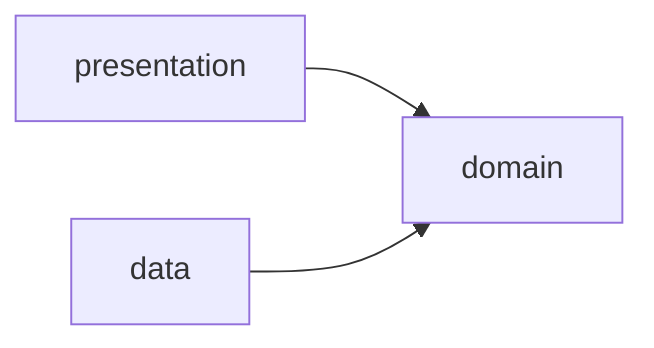
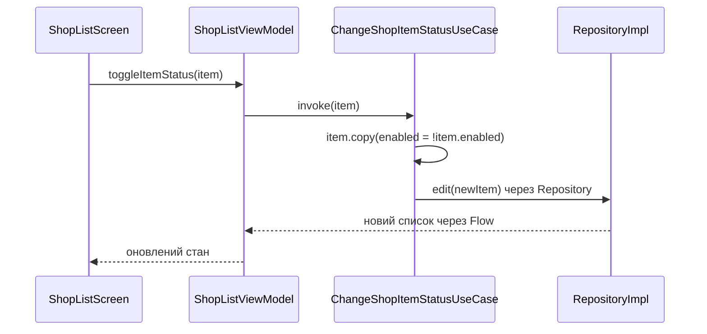
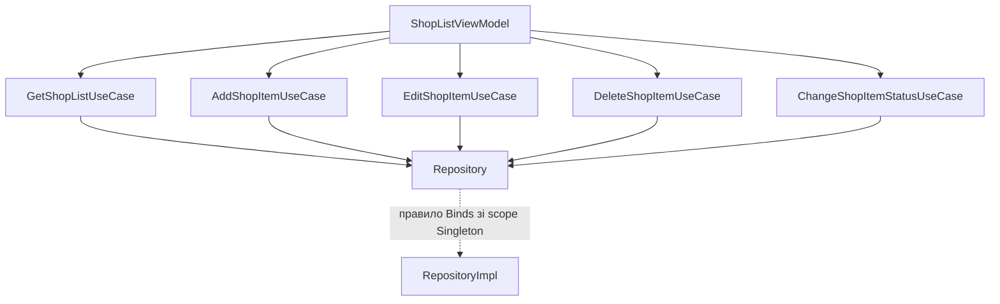

# Clean Architecture в Android: domain, data, presentation та DI

У [попередньому розділі](02_Hilt.md) ми навчилися описувати залежності та складати їх через Hilt. Тепер визначимо, **які класи мають залежати один від одного** і де розміщувати логіку Android-застосунку.

Розглянемо поширений варіант Clean Architecture з трьома шарами: **domain**, **data** та **presentation**. Розберемо список покупок із модуля **`shoplist`** проєкту **`Compose`**: модель `ShopItem`, контракт `Repository` та п’ять use case. На їхньому прикладі покажемо реалізацію data, стан ViewModel, підключення Compose та складання графа через Hilt.

Для прикладу потрібні знання [ViewModel](../05_ViewModel_MVVM/01_ViewModel_and_MVVM.md), [корутин](../06_Concurrency/02_Coroutines_Basics.md), [StateFlow](../06_Concurrency/06_StateFlow_and_SharedFlow.md), Compose та Hilt. У модулі `shoplist` уже налаштовані Hilt і KSP, як у попередній темі. Для presentation використовуємо його наявні Compose-компоненти, Material 3, `viewModelScope`, `collectAsStateWithLifecycle()` з `androidx.lifecycle:lifecycle-runtime-compose` та отримання ViewModel через `by viewModels()` з `androidx.activity.viewModels`.

## 1. Яку проблему розв’язує поділ на шари?

Уявімо ViewModel, яка сама створює Retrofit, виконує запит, розбирає відповідь сервера, змінює статус покупки та формує стан екрана. В одному класі поєднані щонайменше три причини для змін:

- Сервер змінив формат відповіді.
- Змінилося правило перемикання статусу покупки.
- Дизайнер змінив спосіб відображення результату чи помилки.

Розділимо ці обов’язки. Зміна мережевого формату має стосуватися отримання даних, зміна правила — сценарію роботи з покупками, а зміна екрана — його представлення.

Основний принцип Clean Architecture — **залежності вихідного коду спрямовані до внутрішніх правил**. Бізнес-логіка не повинна знати, через яку бібліотеку отримані дані та яким екраном їх показують. Три шари — спосіб застосувати цей принцип в Android, а не вимога створити рівно три каталоги. [Першоджерело: The Clean Architecture](https://blog.cleancoder.com/uncle-bob/2012/08/13/the-clean-architecture.html).

## 2. Обов’язки трьох шарів

| Шар | Основне питання | Типові класи в Android-проєкті |
| --- | --- | --- |
| **domain** | Що вміє застосунок і які правила він виконує? | Моделі предметної області, інтерфейси репозиторіїв, use case |
| **data** | Звідки отримати дані та як їх зберегти? | Реалізації репозиторіїв, джерела даних, Retrofit API, Room DAO, DTO, Entity, mapper-и |
| **presentation** | Як перетворити результат на стан екрана й обробити дії користувача? | ViewModel, UI state, Compose-функції, Activity, Fragment |

### Domain: правила й контракти

Цей шар містить поняття предметної області: `ShopItem`, `Repository`, `AddShopItemUseCase`, `ChangeShopItemStatusUseCase` та інші сценарії. Він не імпортує Activity, Context, Compose, Room або Retrofit.

У наданому проєкті use case використовують `javax.inject.Inject`. Отже, domain залежить від бібліотеки анотацій DI та `kotlinx.coroutines` для `Flow`, але не від Android SDK або Hilt API на зразок `@InstallIn`. Такий компроміс дозволяє Hilt створювати use case без окремих функцій `@Provides`.

**Use case** — клас для одного сценарію застосунку. Наприклад, «додати покупку», «отримати список покупок» або «змінити статус покупки». Він може перевіряти умови, поєднувати результати репозиторіїв і застосовувати правила предметної області.

### Data: реалізація доступу до даних

Репозиторій приховує джерела даних. ViewModel не повинна обирати між API та кешем або знати назви колонок SQLite. Ці рішення приймає реалізація репозиторію; джерело даних виконує конкретні операції з мережею, базою чи пам’яттю. [Data layer в Android](https://developer.android.com/topic/architecture/data-layer).

### Presentation: стан та інтерфейс

ViewModel запускає сценарії та надає стан екрана: список покупок і стан редактора. Для асинхронного джерела сюди також можуть входити ознаки завантаження й помилки. Compose-функція відображає цей стан і передає дії користувача назад через callback-и. Правило перемикання `enabled` не розміщуємо в composable-функції. [UI layer в Android](https://developer.android.com/topic/architecture/ui-layer).

MVVM і Clean Architecture можна використовувати разом: MVVM описує взаємодію View і ViewModel у presentation, а Clean Architecture задає межі між presentation, domain та data.

> **Уточнення щодо документації Android:** Google описує domain як необов’язковий шар для складної або повторно використовуваної бізнес-логіки та окремо застерігає, що його визначення відрізняється від Clean Architecture. Тут обираємо варіант із незалежним domain і контрактами репозиторіїв у ньому. Для невеликого екрана use case, який лише повторює метод репозиторію, може бути зайвим. [Domain layer в Android](https://developer.android.com/topic/architecture/domain-layer).

## 3. Напрямок залежностей: чому data залежить від domain?

Якщо presentation викликає use case, а use case отримує дані, легко намалювати ланцюжок `presentation → domain → data`. Він описує послідовність роботи, але **не залежності вихідного коду** в нашій схемі.

Залежності між шарами такі:



Стрілка означає «використовує типи з цього шару». Domain оголошує інтерфейс `Repository`. Data імпортує його та реалізує у `RepositoryImpl`. Use case залежить від інтерфейсу зі свого шару, а не від конкретної реалізації.

Під час перемикання статусу виклики проходять так:



Повернення списку відбувається через окреме спостереження: ViewModel отримує `Flow` від `GetShopListUseCase`, а репозиторій публікує в ньому зміни після операцій запису. `ChangeShopItemStatusUseCase` не повертає новий список напряму.

Use case викликає метод інтерфейсу, але фактичний об’єкт є реалізацією з data. Так працює знайомий із [теми DI](01_Dependency_Injection.md) принцип інверсії залежностей: внутрішній код визначає контракт, зовнішній підлаштовується під нього.

## 4. Структура прикладу

> 📦 **Початковий проект:** Заготовку проекту списку покупок ви знайдете у репозиторії на GitHub: [krenevych/Compose](https://github.com/krenevych/Compose) (гілка **`main`**, модуль **`shoplist`**).<br>
> 💡 **Приклад розв'язку:** Готовий завершений код списку покупок із поділом на шари та DI через Hilt знаходиться на гілці **`shoplist`** (модуль **`shoplist`**).

Для початку достатньо пакетів в одному Android-модулі. У модулі `shoplist` класи розподілені так:

```text
com.example.shoplist/
├── domain/
│   ├── ShopItem.kt
│   ├── Repository.kt
│   └── usecases/
│       ├── AddShopItemUseCase.kt
│       ├── ChangeShopItemStatusUseCase.kt
│       ├── DeleteShopItemUseCase.kt
│       ├── EditShopItemUseCase.kt
│       └── GetShopListUseCase.kt
├── data/
│   └── RepositoryImpl.kt
├── presentation/
│   ├── ShopListViewModel.kt
│   ├── ShopListScreen.kt
│   ├── ShopItemEditorDialog.kt
│   ├── MainActivity.kt
│   └── theme/
├── di/
│   └── RepositoryModule.kt
└── ShopListApplication.kt
```

`di` — місце складання графа об’єктів. Воно має знати і про контракти, і про їхні реалізації. Це конфігурація застосунку, а не бізнес-логіка domain.

Нижче використовуємо пакети та контракти цього проєкту. Модель, інтерфейс і use case відповідають наданим файлам; реалізацію репозиторію та ViewModel також розглянемо з модуля `shoplist`. Код підключення UI скоротимо до частини, яка показує взаємодію шарів.

## 5. Domain: модель, репозиторій та use case

### Модель покупки

`domain/ShopItem.kt`:

```kotlin
package com.example.shoplist.domain

data class ShopItem(
    val id: Int = 0,
    val name: String = "",
    val count: Int = 0,
    val enabled: Boolean = false
)
```

Поля описують позицію у списку:

| Поле | Призначення |
| --- | --- |
| `id` | Ідентифікатор покупки; при додаванні репозиторій призначає власний ID |
| `name` | Назва продукту |
| `count` | Кількість |
| `enabled` | Чи активна покупка: `true` — активна, `false` — неактивна |

Неактивна покупка залишається у списку: UI може показати її закресленою. Це не видалення. Значення за замовчуванням дозволяють створити `ShopItem()`, але самі по собі не гарантують коректність назви чи кількості.

Модель описує покупку, не спосіб її збереження: тут немає `@Entity`, анотацій серіалізації чи Android-типів.

### Контракт репозиторію

`domain/Repository.kt`:

```kotlin
package com.example.shoplist.domain

import kotlinx.coroutines.flow.Flow

interface Repository {
    val shopList: Flow<List<ShopItem>>
    suspend fun add(item: ShopItem)
    suspend fun edit(item: ShopItem)
    suspend fun delete(item: ShopItem)
    suspend fun getShopItemById(id: Int): ShopItem
}
```

Контракт визначає можливості, потрібні застосунку, але не пояснює, де зберігаються покупки.

- `shopList` — потік поточного списку та його подальших змін.
- `add`, `edit`, `delete` — операції зміни даних.
- `getShopItemById` — отримання окремої покупки за ID.

`Flow` дозволяє підписатися один раз і отримувати зміни після додавання, редагування або видалення. `suspend` в операціях репозиторію дозволяє реалізації виконувати асинхронну роботу, але сам по собі не перемикає потік.

Назва `Repository` збігається з наданим проєктом. Коли репозиторіїв стане більше, конкретніша назва на зразок `ShopListRepository` допоможе їх розрізняти.

### П’ять сценаріїв застосунку

| Use case | Що робить |
| --- | --- |
| `GetShopListUseCase` | Надає потік списку покупок |
| `AddShopItemUseCase` | Додає покупку |
| `EditShopItemUseCase` | Зберігає відредаговану покупку |
| `DeleteShopItemUseCase` | Видаляє покупку |
| `ChangeShopItemStatusUseCase` | Інвертує `enabled` і зберігає результат |

`operator fun invoke()` дозволяє викликати об’єкт як функцію: наприклад, `addShopItemUseCase(item)`.

`domain/usecases/GetShopListUseCase.kt`:

```kotlin
package com.example.shoplist.domain.usecases

import com.example.shoplist.domain.Repository
import javax.inject.Inject

class GetShopListUseCase @Inject constructor(
    private val repository: Repository
) {
    operator fun invoke() = repository.shopList
}
```

Цей `invoke()` не є `suspend`: він лише повертає `Flow<List<ShopItem>>`. Спостереження за значеннями почнеться при збиранні потоку, наприклад через `stateIn` у ViewModel.

`domain/usecases/AddShopItemUseCase.kt`:

```kotlin
package com.example.shoplist.domain.usecases

import com.example.shoplist.domain.Repository
import javax.inject.Inject
import com.example.shoplist.domain.ShopItem

class AddShopItemUseCase @Inject constructor(private val repository: Repository) {
    suspend operator fun invoke(item: ShopItem) {
        repository.add(item)
    }
}
```

`domain/usecases/EditShopItemUseCase.kt`:

```kotlin
package com.example.shoplist.domain.usecases

import com.example.shoplist.domain.Repository
import javax.inject.Inject
import com.example.shoplist.domain.ShopItem

class EditShopItemUseCase @Inject constructor(private val repository: Repository) {
    suspend operator fun invoke(item: ShopItem) {
        repository.edit(item)
    }
}
```

`domain/usecases/DeleteShopItemUseCase.kt`:

```kotlin
package com.example.shoplist.domain.usecases

import com.example.shoplist.domain.Repository
import javax.inject.Inject
import com.example.shoplist.domain.ShopItem

class DeleteShopItemUseCase @Inject constructor(private val repository: Repository) {
    suspend operator fun invoke(item: ShopItem) {
        repository.delete(item)
    }
}
```

Ці три use case поки делегують операції репозиторію. Вони явно позначають сценарії застосунку, але не додають власних перевірок. Наприклад, правило «кількість має бути додатною», якщо воно обов’язкове для всіх способів додавання, можна забезпечити в domain, а не лише у формі введення.

`domain/usecases/ChangeShopItemStatusUseCase.kt`:

```kotlin
package com.example.shoplist.domain.usecases

import com.example.shoplist.domain.Repository
import javax.inject.Inject
import com.example.shoplist.domain.ShopItem

class ChangeShopItemStatusUseCase @Inject constructor(private val repository: Repository) {
    suspend operator fun invoke(item: ShopItem) {
        val newItem = item.copy(enabled = !item.enabled)
        repository.edit(newItem)
    }
}
```

Тут уже є окреме правило: новий статус протилежний попередньому. `copy()` створює новий `ShopItem`, зберігаючи `id`, `name` і `count`, а потім use case передає його репозиторію. Він не знає, чи буде це оновлення `StateFlow`, SQL-запит або HTTP-запит.

Усі use case отримують `Repository` через конструктор. `@Inject` повідомляє Hilt, як їх створити; вибір конкретного репозиторію описуватимемо окремо.

## 6. Data: реалізація репозиторію у пам’яті

`data/RepositoryImpl.kt` реалізує контракт із domain. У цьому проєкті джерело даних — колекція в пам’яті самого репозиторію. Окремий DataSource для такого прикладу не потрібен.

```kotlin
package com.example.shoplist.data

import com.example.shoplist.domain.Repository
import com.example.shoplist.domain.ShopItem
import kotlinx.coroutines.flow.MutableStateFlow
import kotlinx.coroutines.flow.StateFlow
import kotlinx.coroutines.flow.asStateFlow
import javax.inject.Inject

class RepositoryImpl @Inject constructor() : Repository {

    private val items = mutableListOf<ShopItem>()

    private val _shopListFlow = MutableStateFlow(items.toList())
    override val shopList: StateFlow<List<ShopItem>> = _shopListFlow.asStateFlow()

    private var nextId = 0

    init {
        addItem(ShopItem(name = "Молоко", count = 2, enabled = true))
        addItem(ShopItem(name = "Хліб", count = 1, enabled = true))
        addItem(ShopItem(name = "Яблука", count = 5, enabled = false))
        addItem(ShopItem(name = "Яйця", count = 10, enabled = true))
        addItem(ShopItem(name = "Кава", count = 1, enabled = false))
    }

    override suspend fun add(item: ShopItem) {
        addItem(item)
    }

    private fun addItem(item: ShopItem) {
        items.add(item.copy(id = nextId++))
        _shopListFlow.value = items.toList()
    }

    override suspend fun edit(item: ShopItem) {
        val index = items.indexOfFirst { it.id == item.id }
        if (index == -1) {
            throw NoSuchElementException("Shop item with id ${item.id} not found")
        }
        items[index] = item
        _shopListFlow.value = items.toList()
    }

    override suspend fun delete(item: ShopItem) {
        items.removeAll { it.id == item.id }
        _shopListFlow.value = items.toList()
    }

    override suspend fun getShopItemById(id: Int): ShopItem {
        return items.find { it.id == id }
            ?: throw NoSuchElementException("Shop item with id $id not found")
    }
}
```

Реалізація приховує кілька рішень:

1. Ідентифікатори призначаються через `nextId`, починаючи з `0`; ID переданого в `add()` об’єкта замінюється.
2. Редагування та видалення шукають покупку за `id`, а не за назвою чи збігом усіх полів.
3. Після зміни колекції публікується новий знімок через `items.toList()`.
4. Якщо покупку для редагування або читання не знайдено, виникає `NoSuchElementException`. Видалення відсутнього ID нічого не змінює.

Зовнішній код отримує тільки `StateFlow`, тому не може присвоювати значення приватному `MutableStateFlow`. Контракт оголошує ширший тип `Flow`, а реалізація надає `StateFlow` як його підтип.

Тут data використовує `ShopItem` без додаткової моделі зберігання: для списку в пам’яті цього достатньо. Якщо з’явиться Room Entity або мережевий DTO, їх перетворюватимемо на `ShopItem` усередині data. Domain не повинен імпортувати формат конкретного джерела.

Ця реалізація не зберігає покупки після завершення процесу. Її операції короткі, не мають точок призупинення та в наведеному UI викликаються з головного потоку. Mutable-колекція й `nextId` не захищені від паралельного доступу з різних потоків: для такого використання потрібна синхронізація, наприклад `Mutex`.

При переході до блокувального читання файлів забезпечте main-safe операції у data через `withContext` та IO-диспетчер. Саме ключове слово `suspend` не перемикає потік. [Main-safe функції в data layer](https://developer.android.com/topic/architecture/data-layer#threading).

## 7. Presentation: ViewModel, стан редактора та Compose

`presentation/ShopListViewModel.kt` отримує всі п’ять use case:

```kotlin
package com.example.shoplist.presentation

import androidx.lifecycle.ViewModel
import androidx.lifecycle.viewModelScope
import com.example.shoplist.domain.ShopItem
import com.example.shoplist.domain.usecases.AddShopItemUseCase
import com.example.shoplist.domain.usecases.ChangeShopItemStatusUseCase
import com.example.shoplist.domain.usecases.GetShopListUseCase
import com.example.shoplist.domain.usecases.EditShopItemUseCase
import com.example.shoplist.domain.usecases.DeleteShopItemUseCase
import dagger.hilt.android.lifecycle.HiltViewModel
import kotlinx.coroutines.flow.SharingStarted
import kotlinx.coroutines.flow.StateFlow
import kotlinx.coroutines.flow.stateIn
import kotlinx.coroutines.flow.MutableStateFlow
import kotlinx.coroutines.flow.asStateFlow
import kotlinx.coroutines.launch
import javax.inject.Inject

@HiltViewModel
class ShopListViewModel @Inject constructor(
    private val getShopListUseCase: GetShopListUseCase,
    private val addShopItemUseCase: AddShopItemUseCase,
    private val changeShopItemStatusUseCase: ChangeShopItemStatusUseCase,
    private val editShopItemUseCase: EditShopItemUseCase,
    private val deleteShopItemUseCase: DeleteShopItemUseCase,
) : ViewModel() {
    private val _editor = MutableStateFlow<ShopItemEditorState?>(null)
    val editor: StateFlow<ShopItemEditorState?> = _editor.asStateFlow()

    fun startAdding() {
        _editor.value = ShopItemEditorState()
    }

    fun startEditing(item: ShopItem) {
        _editor.value = ShopItemEditorState(item = item)
    }

    fun dismissEditor() {
        if (_editor.value?.isSaving != true) _editor.value = null
    }

    fun saveItem(name: String, count: Int) {
        val editor = _editor.value ?: return
        if (editor.isSaving || name.isBlank() || count <= 0) return
        _editor.value = editor.copy(isSaving = true)
        viewModelScope.launch {
            val item = editor.item?.copy(name = name.trim(), count = count)
                ?: ShopItem(name = name.trim(), count = count, enabled = true)
            if (editor.item == null) addShopItemUseCase(item) else editShopItemUseCase(item)
            _editor.value = null
        }
    }

    fun deleteItem(item: ShopItem) {
        viewModelScope.launch { deleteShopItemUseCase(item) }
    }

    fun toggleItemStatus(item: ShopItem) {
        viewModelScope.launch { changeShopItemStatusUseCase(item) }
    }

    val shopList: StateFlow<List<ShopItem>> = getShopListUseCase()
        .stateIn(
            scope = viewModelScope,
            started = SharingStarted.WhileSubscribed(5_000),
            initialValue = emptyList()
        )
}

data class ShopItemEditorState(
    val item: ShopItem? = null,
    val isSaving: Boolean = false
)
```

У ViewModel є два види стану:

- `shopList` — поточні покупки, які надходять із репозиторію через `GetShopListUseCase`.
- `editor` — стан UI: чи відкритий редактор, яка покупка редагується та чи триває збереження. `null` означає, що діалог закритий.

`stateIn` перетворює доступний через контракт потік на `StateFlow` ViewModel. `WhileSubscribed(5_000)` підтримує підписку, поки є споживачі, і ще п’ять секунд після їх зникнення; початкове значення — порожній список. Це не окремий стан завантаження: для мережевого джерела його варто моделювати явно. [Документація `stateIn`](https://kotlinlang.org/api/kotlinx.coroutines/kotlinx-coroutines-core/kotlinx.coroutines.flow/state-in.html).

`saveItem()` обирає між додаванням та редагуванням за станом редактора. Для нової покупки він задає `enabled = true`, для наявної зберігає ID і статус через `copy()`. Перевірка `isSaving` запобігає повторному збереженню під час поточної операції. Валідація форми тут мінімальна; обов’язкові бізнес-обмеження потрібно також забезпечити на рівні domain.

ViewModel не імпортує `RepositoryImpl` і не виконує `items.add()`. Метод `toggleItemStatus()` лише запускає use case; інверсія `enabled` залишається у domain.

> Це навчальна ViewModel з наявного проєкту. Для джерела, яке може завершуватися помилкою, потрібно окремо обробити помилки потоку й операцій запису, скинути `isSaving` після невдалого збереження та показати стан помилки. `CancellationException` слід передавати далі. Сам `stateIn` не перетворює помилку джерела на стан UI.

### Як екран передає дії у ViewModel

У модулі вже є `ShopListScreen` і `ShopItemEditorDialog`; нижче використовуємо їхні наявні параметри, не повторюючи код карток, свайпів та полів введення. Цю функцію можна розмістити в presentation поруч з екраном:

```kotlin
package com.example.shoplist.presentation

import androidx.compose.foundation.layout.Column
import androidx.compose.foundation.layout.fillMaxSize
import androidx.compose.material3.Button
import androidx.compose.material3.Text
import androidx.compose.runtime.Composable
import androidx.compose.runtime.getValue
import androidx.compose.ui.Modifier
import androidx.lifecycle.compose.collectAsStateWithLifecycle

@Composable
fun ShopListRoute(viewModel: ShopListViewModel) {
    val items by viewModel.shopList.collectAsStateWithLifecycle()
    val editor by viewModel.editor.collectAsStateWithLifecycle()

    Column(modifier = Modifier.fillMaxSize()) {
        Button(onClick = viewModel::startAdding) {
            Text("Додати покупку")
        }
        ShopListScreen(
            items = items,
            modifier = Modifier.weight(1f),
            onItemClick = viewModel::startEditing,
            onItemLongClick = viewModel::toggleItemStatus,
            onItemDelete = viewModel::deleteItem
        )
    }

    editor?.let { state ->
        ShopItemEditorDialog(
            state = state,
            onDismiss = viewModel::dismissEditor,
            onSave = viewModel::saveItem
        )
    }
}
```

Коротке натискання на покупку відкриває редактор, довге змінює статус, а свайп викликає видалення. Збереження діалогу запускає `saveItem()`. Самі `ShopListScreen` і `ShopItemEditorDialog` працюють зі станом і callback-ами, тому не потребують доступу до Hilt чи репозиторію.

Після зміни даних не потрібно вручну перечитувати список: `RepositoryImpl` оновлює потік, ViewModel отримує нове значення, а Compose перемальовує список.

## 8. Як шари з’єднуються через DI

Hilt уже знає, як викликати конструктори use case і `RepositoryImpl`, бо вони позначені `@Inject`. Залишилося пояснити, **який об’єкт надати для інтерфейсу `Repository`**.

### `@Binds`: обираємо реалізацію контракту

`di/RepositoryModule.kt`:

```kotlin
package com.example.shoplist.di

import com.example.shoplist.data.RepositoryImpl
import com.example.shoplist.domain.Repository
import dagger.Binds
import dagger.Module
import dagger.hilt.InstallIn
import dagger.hilt.components.SingletonComponent
import javax.inject.Singleton

@Module
@InstallIn(SingletonComponent::class)
abstract class RepositoryModule {
    @Binds
    @Singleton
    abstract fun bindRepository(implementation: RepositoryImpl): Repository
}
```

Це інструкція для Hilt: **коли потрібен `Repository`, використай `RepositoryImpl`**. Інтерфейс залишається в domain, реалізація — у data, а знання про їхню відповідність — у конфігурації DI. Domain не імпортує цей модуль.

### Чому тут потрібен `@Singleton`?

Репозиторій володіє змінним станом — списком покупок. Без scope кожен use case міг би отримати власний `RepositoryImpl`: один екземпляр для спостереження, інший для додавання, ще один для видалення. Зміни одного списку не потрапляли б у потік іншого.

`@Singleton` на binding-методі забезпечує спільний `Repository` у межах `SingletonComponent`. Тому всі п’ять use case працюють з одним списком і одним потоком. Для цього всі вони запитують саме `Repository`, як у наданих конструкторах.

`@InstallIn(SingletonComponent::class)` визначає компонент, у якому доступне правило, але саме по собі не забезпечує спільний екземпляр. Singleton також не означає збереження після завершення процесу та не робить mutable-колекцію потокобезпечною. [Компоненти та scope Hilt](https://dagger.dev/hilt/components.html).

### Створення use case через `@Inject`

У всіх наданих use case вже є `@Inject constructor`. Hilt отримує `Repository` за правилом `@Binds` та передає його цим конструкторам. Окремі `@Provides` для use case не потрібні.

Якщо потрібно прибрати навіть залежність від `javax.inject` у domain, можна залишити звичайні конструктори, а створення use case винести у `@Provides`-методи в DI. У цьому розділі зберігаємо варіант із наданих файлів.

### Повний граф створення



Ця схема показує **граф об’єктів**, а не залежності між пакетами. Hilt знаходить правила для залежностей ViewModel, отримує спільний репозиторій і передає його конструкторам use case. Domain при цьому не починає залежати від data.

З боку ViewModel не потрібні ні `RepositoryImpl()`, ні звернення до глобального контейнера. Саму ViewModel отримуємо через механізм Jetpack ViewModel, наприклад `by viewModels()` в Activity. [Hilt View Models](https://dagger.dev/hilt/view-model.html).

## 9. Точка входу Android-застосунку

`ShopListApplication.kt`:

```kotlin
package com.example.shoplist

import android.app.Application
import dagger.hilt.android.HiltAndroidApp

@HiltAndroidApp
class ShopListApplication : Application()
```

У наявному елементі `<application>` файла `AndroidManifest.xml` має бути `android:name="com.example.shoplist.ShopListApplication"`. Якщо власний Application уже є, анотацію додають до нього, а не реєструють другий клас.

Скорочений варіант `presentation/MainActivity.kt` для підключення показаної вище `ShopListRoute`:

```kotlin
package com.example.shoplist.presentation

import android.os.Bundle
import androidx.activity.ComponentActivity
import androidx.activity.compose.setContent
import androidx.activity.viewModels
import androidx.compose.material3.MaterialTheme
import dagger.hilt.android.AndroidEntryPoint

@AndroidEntryPoint
class MainActivity : ComponentActivity() {
    private val viewModel: ShopListViewModel by viewModels()

    override fun onCreate(savedInstanceState: Bundle?) {
        super.onCreate(savedInstanceState)
        setContent {
            MaterialTheme {
                ShopListRoute(viewModel)
            }
        }
    }
}
```

Екран покаже початкові покупки з репозиторію: молоко, хліб, яблука, яйця та каву. Неактивні позиції не відфільтровуються — їхній вигляд визначає presentation. Додавання, редагування, перемикання статусу та видалення змінюють спільний репозиторій, а його `Flow` оновлює екран.

## 10. Де тепер будуть Room, Retrofit та Context?

| Потреба | Де її реалізувати |
| --- | --- |
| Запит до сервера | API та віддалене джерело у data |
| Запити до бази | DAO, Entity та локальне джерело у data |
| Вибір між кешем і мережею | Реалізація репозиторію у data |
| Перетворення DTO або Entity на `ShopItem` | Mapper у data |
| Призначення ID при додаванні | Реалізація репозиторію або його джерело даних |
| Створення Retrofit чи Room через Builder | `@Provides` у конфігурації DI |
| Контекст для створення Room | `@ApplicationContext Context` у DI-функції створення бази |
| Правило зміни статусу покупки | `ChangeShopItemStatusUseCase` у domain |
| Відкриття редактора, підсвічування чи закреслення позиції | Presentation |

Наприклад, заміна колекції в пам’яті на Room змінить data та конфігурацію DI. Якщо реалізація збереже контракт `Repository`, включно з потоком змін `shopList`, use case та ViewModel продовжать працювати з ним. Одноразового завантаження через Retrofit недостатньо, щоб автоматично забезпечити той самий реактивний контракт: публікацію змін має організувати data.

У попередній темі ми показали, як ін’єктувати `Context` безпосередньо у ViewModel. Тут спочатку визначаємо, для чого він потрібен: якщо для бази чи файлів, залежність від Android передаємо відповідному класу data, а ViewModel отримує сценарії роботи з покупками.

## 11. Перевірка domain без Android та Hilt

Для перевірки use case можна створити його звичайним викликом конструктора й передати тестовий репозиторій. Анотація `@Inject` не вимагає запускати Hilt у кожному тесті.

Приклад локального тесту `ChangeShopItemStatusUseCase` у `src/test` із JUnit 4 та корутинами:

```kotlin
import com.example.shoplist.domain.Repository
import com.example.shoplist.domain.ShopItem
import com.example.shoplist.domain.usecases.ChangeShopItemStatusUseCase
import kotlinx.coroutines.flow.Flow
import kotlinx.coroutines.flow.flowOf
import kotlinx.coroutines.runBlocking
import org.junit.Assert.assertEquals
import org.junit.Test

class ChangeShopItemStatusUseCaseTest {
    @Test
    fun togglesStatusAndPreservesOtherFields() = runBlocking {
        for (enabled in listOf(true, false)) {
            val repository = RecordingRepository()
            val original = ShopItem(7, "Молоко", 2, enabled)

            ChangeShopItemStatusUseCase(repository)(original)

            assertEquals(
                ShopItem(7, "Молоко", 2, !enabled),
                repository.editedItem
            )
            assertEquals(enabled, original.enabled)
        }
    }
}

private class RecordingRepository : Repository {
    var editedItem: ShopItem? = null
        private set

    override val shopList: Flow<List<ShopItem>> = flowOf(emptyList())

    override suspend fun edit(item: ShopItem) {
        editedItem = item
    }

    override suspend fun add(item: ShopItem): Unit = error("Не використовується")
    override suspend fun delete(item: ShopItem): Unit = error("Не використовується")
    override suspend fun getShopItemById(id: Int): ShopItem = error("Не використовується")
}
```

Тестовий репозиторій запам’ятовує передане в `edit()` значення. Перевіряємо обидва напрямки зміни статусу, збереження інших полів та незмінність початкового об’єкта. Решта операцій навмисно не реалізована: цей сценарій не повинен їх викликати.

Для такого тесту не потрібні емулятор, база даних або Hilt-контейнер. Сам domain при цьому має залежності від `kotlinx.coroutines` і бібліотеки анотацій `javax.inject`, як у вихідному проєкті.

## 12. Пакети чи окремі Gradle-модулі?

Пакети допомагають організувати код, але не забороняють неправильний імпорт. Коли потрібні перевірені компілятором межі, шари можна винести в модулі:

```text
:domain        звичайний Kotlin/JVM-модуль
:data          залежить від :domain
:presentation  залежить від :domain
:app           залежить від :presentation, :data та :domain; містить DI і точку входу
```

У цьому варіанті `:domain` не має Gradle-залежності на `:data`, тому імпортувати його реалізацію не вийде. `:app` бачить обидві сторони та з’єднує їх. Якщо data використовує Room або інші Android API, йому потрібен Android library plugin; presentation із Compose та ViewModel також зазвичай є Android library-модулем. У модулях з оброблюваними Hilt-анотаціями налаштовують відповідні залежності та KSP.

Це можливе продовження прикладу, а не вимога одразу розбивати невеликий застосунок. Деталі підключення Hilt між модулями описані в [документації для multimodule apps](https://developer.android.com/training/dependency-injection/hilt-multi-module).

## 13. Типові помилки та запитання для перевірки

| Помилка | Що змінити |
| --- | --- |
| Use case створює `RepositoryImpl` | Приймати `Repository` через конструктор |
| Domain повертає Retrofit `Response` або Room Entity | Визначити контракт через моделі domain, перетворювати формати у data |
| ViewModel звертається до DAO чи API | Передати сценарій або контракт, приховавши джерело у data |
| Composable сам інвертує `enabled` і зберігає покупку | Передати дію у ViewModel та `ChangeShopItemStatusUseCase` |
| У domain додали `Context` для роботи з базою | Перенести створення бази та доступ до неї у data/DI |
| Створили пакети, але domain імпортує data | Виправити напрямок залежності; самі назви пакетів меж не забезпечують |
| Кожен use case отримує окремий репозиторій зі своїм списком | Задати спільний scope для `Repository` у DI |
| Вважаємо, що Hilt автоматично забезпечує Clean Architecture | Окремо перевіряти межі шарів: Hilt перевіряє граф створення, а не розподіл обов’язків |

Спробуйте відповісти:

1. Чому інтерфейс `Repository` у цьому прикладі належить domain, а `RepositoryImpl` — data?
2. Чим відрізняється схема викликів від схеми залежностей коду?
3. Які файли зміняться, якщо джерело в пам’яті замінити на Retrofit API?
4. Чому `GetShopListUseCase.invoke()` не є `suspend`, а зміна статусу покупки запускається в корутині?
5. Що зламається без `@Singleton` на binding-методі репозиторію в пам’яті?

Попередня тема: [«Hilt: від ручного `inject()` до автоматичного складання залежностей»](02_Hilt.md).
